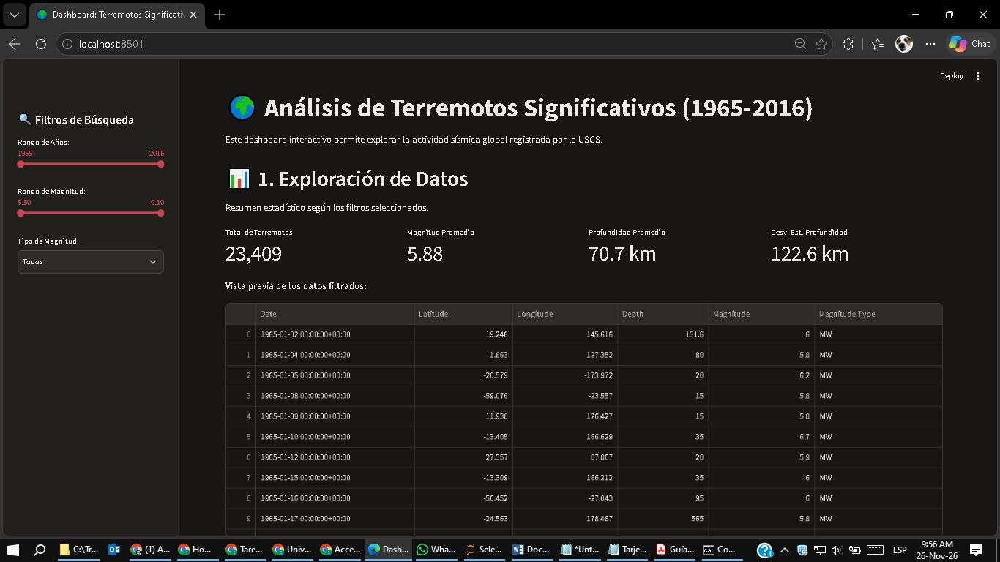

# Dashboard interactivo de análisis de terremotos (1965-2016)

## Descripción del proyecto

Este proyecto presenta un análisis exploratorio de datos (EDA) de registros históricos de terremotos ocurridos en diferentes partes del mundo entre 1965 y 2016. El propósito es identificar patrones y características de los eventos sísmicos mediante herramientas de análisis estadístico y visualización de datos.

Para desarrollar el análisis se utilizó un conjunto de datos en formato CSV que contiene información como fecha, ubicación geográfica, magnitud, profundidad y tipo de magnitud de los terremotos. Se seleccionó esta información porque permite estudiar el comportamiento de los eventos sísmicos y explorar la relación entre sus principales variables.

El proyecto incluye un dashboard interactivo desarrollado con Python y Streamlit, que permite consultar los registros mediante filtros y visualizar los resultados de forma sencilla.

## Captura del dashboard



## Dashboard publicado

[Consultar el dashboard interactivo en Streamlit](https://tarea4dashboardterremotossignificativos.streamlit.app/)

## Hallazgos principales del análisis

- La magnitud promedio de los terremotos registrados es aproximadamente 5.88.
- Se observa una alta variabilidad en la profundidad de los eventos sísmicos, con registros que van desde valores cercanos a la superficie hasta aproximadamente 700 km.
- Los terremotos de magnitudes muy elevadas son poco frecuentes en comparación con los eventos de menor magnitud.
- Las correlaciones entre magnitud, profundidad y coordenadas geográficas son bajas, por lo que no se identifica una relación lineal fuerte entre estas variables.
- La profundidad por sí sola no permite determinar el impacto de un terremoto, ya que también influyen factores como la ubicación, la población expuesta y las características del terreno.

## Tecnologías utilizadas

- Python
- Jupyter Notebook
- Streamlit
- Pandas
- NumPy
- Matplotlib
- Seaborn
- SciPy


## Instalación y ejecución Local

Para ejecutar el proyecto en un computador, se deben seguir estos pasos:

1. Clonar el repositorio:

 	  ```bash
  	 git clone https://github.com/TU-USUARIO/dashboard-terremotos.git


2. Ingresar a la carpeta del proyecto:
	cd dashboard-terremotos

3. Instalar las librerías necesarias:
	pip install -r requirements.txt

4. Ejecutar la aplicación: 

	streamlit run app.py

5. Abrir en el navegador la dirección local que proporciona Streamlit, normalmente:

	http://localhost:8501


## Información académica
**Estudiante:** Carlos Adrian Jaramillo Vega
**Curso:** Programación para el Análisis de Datos
**Universidad:** Universidad Nacional Abierta y a Distancia (UNAD)
**Fecha:** 26 de noviembre de 2026


